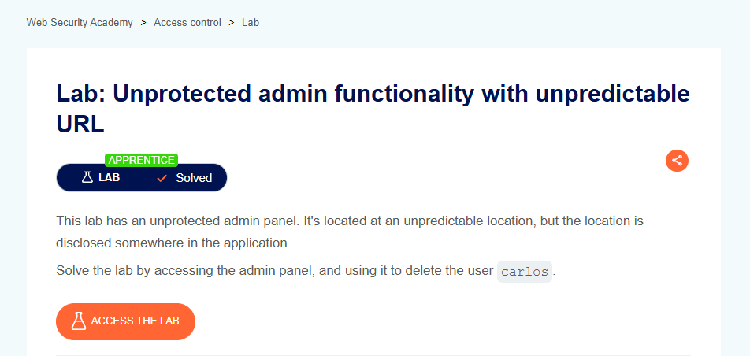

# Unprotected Admin Functionality with Unpredictable URL

## Lab Result

## Lab Description

This lab demonstrates how sensitive administrative functionality can still be discovered and accessed when authorization controls are not properly implemented, even when the URL is not easily predictable.

## What I Learned

- Access control must be enforced regardless of URL complexity.
- Hidden or unpredictable URLs should not be considered a security control.
- Administrative functionality requires proper authorization checks.
- Security through obscurity is not an effective defense mechanism.

## Tools Used

- Burp Suite
- PortSwigger Web Security Academy
- Browser Developer Tools

## Key Takeaways

- Administrative endpoints should always verify user permissions.
- URL secrecy alone cannot protect sensitive functionality.
- Proper authorization should be implemented on the server side.
- Access control testing is an important part of web application security assessments.

## Status

✅ Solved
