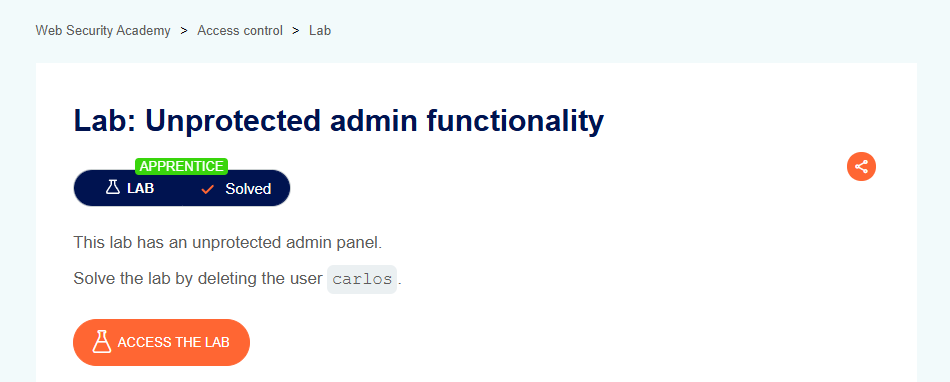

# Unprotected Admin Functionality

## Lab Result

## Lab Description

This lab demonstrates how administrative functionality can be exposed without proper access control mechanisms, allowing unauthorized users to access privileged features.

## What I Learned

- Access control is essential for protecting sensitive functionality.
- Administrative features should be restricted to authorized users only.
- Security should not rely on obscurity or hidden URLs.
- Proper authorization checks must be enforced on every sensitive action.

## Tools Used

- Burp Suite
- PortSwigger Web Security Academy
- Browser Developer Tools

## Key Takeaways

- Hidden functionality is not the same as protected functionality.
- Every administrative feature requires proper authorization controls.
- Access control should be validated on the server side.
- Security testing should include authorization checks.

## Status

✅ Solved
