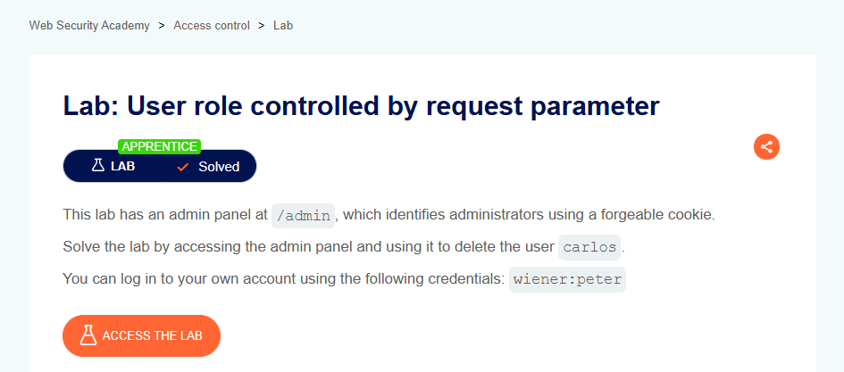

# User Role Controlled by Request Parameter

## Lab Result

## Lab Description

This lab demonstrates how access control can be bypassed when user roles are determined by client-controlled request parameters instead of being securely enforced on the server side.

## What I Learned

- Access control decisions should never rely on user-controlled data.
- Request parameters can be manipulated if they are not properly validated.
- User roles and permissions must be verified on the server side.
- Improper authorization can lead to privilege escalation.

## Tools Used

- Burp Suite
- PortSwigger Web Security Academy
- Browser Developer Tools

## Key Takeaways

- Never trust client-side parameters for authorization decisions.
- Role-based access control should be enforced server-side.
- User privileges should be validated for every sensitive action.
- Authorization testing is a critical part of web application security.

## Status

✅ Solved
