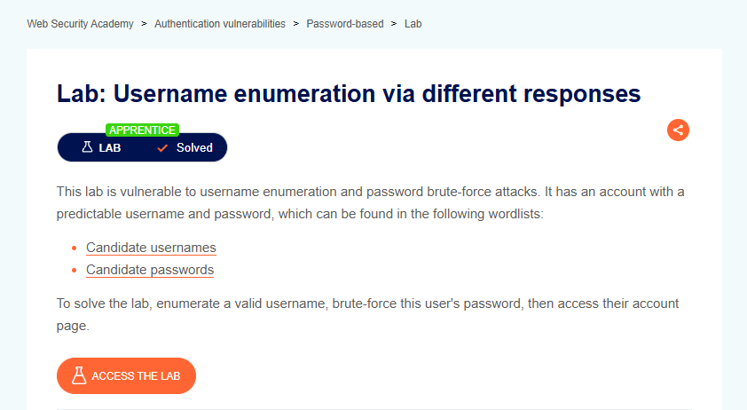

# Username Enumeration via Different Responses

## Lab Result

## Lab Description

This lab demonstrates how different authentication responses can expose valid usernames. By comparing server responses during login attempts, an attacker can identify existing accounts before performing password enumeration.

## What I Learned

- Authentication responses should be consistent to prevent username enumeration.
- Response length differences may reveal valid usernames.
- Error messages can unintentionally disclose sensitive information.
- Attackers can reduce brute-force scope by identifying valid accounts first.
- Authentication mechanisms should avoid providing distinguishable feedback.

## Tools Used

- Burp Suite Community Edition
- Burp Intruder
- PortSwigger Web Security Academy

## Key Takeaways

- Username enumeration is an information disclosure vulnerability.
- Response analysis can reveal valid usernames even when status codes remain identical.
- Response length can be used to identify anomalies during authentication testing.
- Consistent error handling is important for secure authentication systems.
- Authentication testing is a fundamental part of web application security assessments.

## Status

✅ Solved
