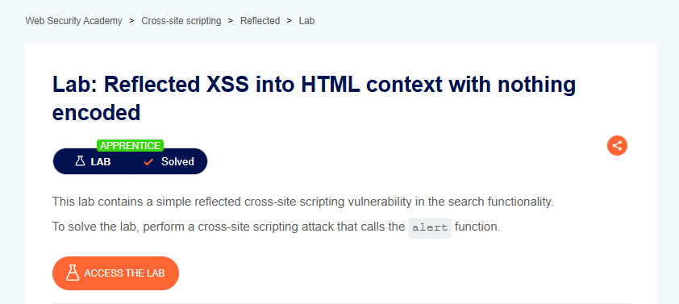

# Reflected XSS into HTML Context with Nothing Encoded

## Lab Result



---

## Lab Description

This lab demonstrates a Reflected Cross-Site Scripting (XSS) vulnerability where user-supplied input is reflected directly into the HTML response without any encoding or sanitization.

An attacker can inject arbitrary JavaScript code that executes in the victim's browser.

---

## Proof of Concept

### Payload

```html
<script>alert(1)</script>
```

### Example Request

```http
GET /?search=<script>alert(1)</script>
```

The payload is reflected into the page and executed by the browser because the application fails to encode user input before rendering it within the HTML response.

---

## What I Learned

- Understanding how Reflected XSS vulnerabilities occur.
- Identifying untrusted user input reflected in HTML responses.
- Testing XSS payloads within search functionality.
- Understanding browser-side JavaScript execution.
- Recognizing the security impact of insufficient input handling.

---

## Tools Used

- Burp Suite Community Edition
- Burp Proxy
- Burp Repeater
- PortSwigger Web Security Academy

---

## Key Takeaways

- User input should never be rendered directly into HTML responses.
- Output encoding is critical for preventing XSS vulnerabilities.
- Reflected XSS can lead to session theft and malicious script execution.
- Even simple search functionality can introduce security risks.
- Proper input validation and output encoding should always be implemented.

---

## Status

✅ Solved
