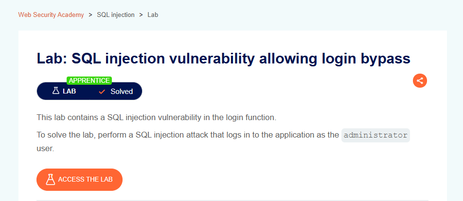

# SQL Injection Vulnerability Allowing Login Bypass

## Lab Result

## Lab Description

This lab demonstrates how insecure authentication logic can be manipulated through SQL injection, allowing unauthorized access to an application.

## What I Learned

- Authentication workflows can be affected by improper input handling.
- SQL injection may lead to unauthorized access if user input is not properly validated.
- Secure authentication mechanisms rely on parameterized queries and proper input validation.

## Tools Used

- Burp Suite
- PortSwigger Web Security Academy

## Key Takeaways

- Never trust user-supplied input.
- Implement parameterized queries to prevent SQL injection.
- Authentication controls should not rely on insecure database queries.

## Status

✅ Solved
