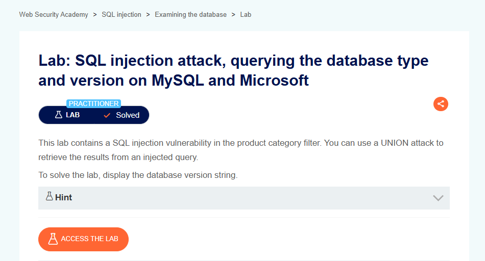

# SQL Injection Attack, Querying the Database Type and Version on MySQL and Microsoft

## Lab Result

## Lab Description

This lab demonstrates how SQL injection can be used to identify backend database technologies and retrieve version information from MySQL and Microsoft database systems.

## What I Learned

- Database fingerprinting concepts
- Differences between database platforms
- Information disclosure risks
- Database version enumeration techniques
- Security implications of exposed system information

## Tools Used

- Burp Suite
- PortSwigger Web Security Academy

## Key Takeaways

- Exposed database information may assist reconnaissance activities.
- Version disclosure can increase security risks.
- Applications should minimize unnecessary information exposure.
- Secure coding practices help mitigate SQL injection vulnerabilities.

## Status

✅ Solved
