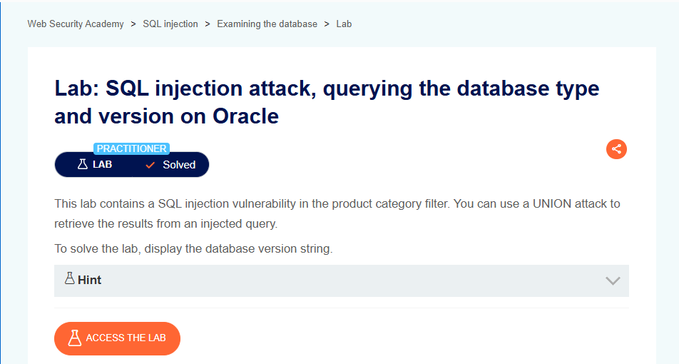

# SQL Injection Attack, Querying the Database Type and Version on Oracle

## Lab Result

## Lab Description

This lab demonstrates how SQL injection can be used to identify the backend database type and version information when application queries are not properly secured.

## What I Learned

- Database fingerprinting concepts
- Oracle database characteristics
- Information disclosure risks
- How exposed version information can assist security assessments
- The importance of minimizing unnecessary system information exposure

## Tools Used

- Burp Suite
- PortSwigger Web Security Academy

## Key Takeaways

- Information disclosure can increase security risks.
- Database versions should not be unnecessarily exposed.
- Secure application design helps reduce reconnaissance opportunities.
- Input validation remains a critical security control.

## Status

✅ Solved
