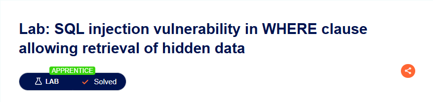

# SQL Injection Vulnerability in WHERE Clause Allowing Retrieval of Hidden Data

## Lab Result

## Summary

This lab demonstrates how improper input validation can expose information that should not be accessible to users.

## What I Learned

- Basic SQL injection concepts
- SQL query manipulation
- Importance of input validation
- Risks of exposing sensitive information

## Tools Used

- Burp Suite
- PortSwigger Web Security Academy

## Status

✅ Solved
